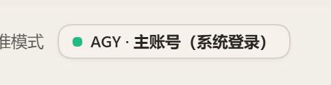
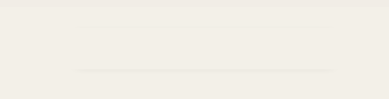

# dsh-agy-link-delete-top

隐藏 DeepSeek Harness（DSH）会话顶部的 AGY 账号标识。

安装 [dsh-agy-link](https://github.com/amlyczz/dsh-agy-link) 后，每个会话顶部会出现一个 AGY 账号徽章（点亮的绿点 + 当前账号）。该插件 0.4.70 版本没有提供隐藏开关，本插件用一条 CSS 规则把它隐藏，其余功能不受影响。

## 效果

安装前（会话顶部的 AGY 徽章）：



安装后（徽章隐藏，工具栏其余部分不变）：



## 原理

dsh-agy-link 的客户端在 `conversation.session.header.actions` 插槽注册了 `agy-link-status` 组件，渲染出这个按钮。本插件不改动它的文件、不卸载组件，只注入一段样式，匹配它的稳定特征并将其 `display: none`：

- `button.agy-btn`，`title` 以 “Antigravity” 开头（四种语言一致）
- 背景使用 `--agy-bg-header` 变量（区别于 AGY 控制台内的其他按钮）
- 徽章外层的单子元素包裹容器一并折叠，避免留下空位

因此：

- AGY 登录、模型调用、账号池、额度刷新全部正常
- 设置页的 Antigravity 管理入口保留
- 控制台弹窗通过 portal 渲染到 `document.body`，不受影响
- 禁用或卸载本插件后徽章立即恢复显示

## 安装

### 通过 GitHub 地址安装（推荐）

1. 在 DSH 中打开 **设置 → 插件 → 添加插件 → 安装第三方插件**。
2. 粘贴以下仓库地址，然后按界面提示确认安装：

   ```text
   https://github.com/liubaicai/dsh-agy-link-delete-top
   ```

3. 安装完成后刷新页面；如果 DSH 提示需要重启，请按提示重启。

上面的地址安装仓库默认分支的代码。若要固定安装已发布的 `v0.1.0`，改填：

```text
https://github.com/liubaicai/dsh-agy-link-delete-top#v0.1.0
```

也支持 GitHub 简写：

```text
github:liubaicai/dsh-agy-link-delete-top#v0.1.0
```

本仓库是公开仓库，HTTPS 地址不需要配置个人 SSH 密钥。安装 Git 仓库需要运行 DSH 的机器安装 Git，并能访问 GitHub；更换 npm 镜像不会解决 GitHub 的连接问题。遇到 Git 连接或构建问题，可以改用下面的发布包直链。

### 通过发布包安装

在同一个安装输入框中粘贴以下地址，可以直接安装 `v0.1.0` 发布包，无需手动下载：

```text
https://github.com/liubaicai/dsh-agy-link-delete-top/releases/download/v0.1.0/dsh-agy-link-delete-top-0.1.0.tgz
```

也可以从 [Releases](https://github.com/liubaicai/dsh-agy-link-delete-top/releases) 下载发布包，再在输入框中填写它在运行 DSH 的机器上的**绝对路径**；不必放到特定目录。

### 命令行安装（非桌面端 profile）

命令行管理的配置（例如 `web`）可以运行：

```bash
# 从 GitHub 固定安装 v0.1.0
dsh plugin --profile web add "github:liubaicai/dsh-agy-link-delete-top#v0.1.0"

# 或从 GitHub 安装默认分支
dsh plugin --profile web add "github:liubaicai/dsh-agy-link-delete-top"

# 或安装发布包直链
dsh plugin --profile web add "https://github.com/liubaicai/dsh-agy-link-delete-top/releases/download/v0.1.0/dsh-agy-link-delete-top-0.1.0.tgz"
```

以上是三种替代方式，任选一种即可。将 `web` 替换为实际使用的 profile。桌面端的 `desktop` profile 由 Electron 应用管理，不支持用这条 CLI 命令安装，请使用上面的图形界面入口。安装完成后刷新页面，必要时按提示重启 DSH。

## 恢复显示

在 设置 → 插件 中停用或移除本插件，徽章立即恢复显示。命令行配置也可以：

```bash
dsh plugin --profile web remove dsh-agy-link-delete-top
```

## 兼容性说明

- 针对 dsh-agy-link 0.4.70 的徽章结构编写。徽章的 `title` 前缀与背景变量在上游变更前都保持稳定；若某次升级后徽章重新出现，通常是选择器特征变了，更新本插件即可，不会影响 dsh-agy-link 本身。
- 需要浏览器支持 `:has()`（Chrome 105+ / Edge 105+；DSH 桌面端与网页端均满足）。

## 开发

```bash
npm install
npm test        # jsdom 验证隐藏规则与边界情况
npm pack        # 产出可安装的 .tgz
```

测试覆盖：徽章与其包裹层被隐藏；非 Antigravity 标题或无该背景变量的按钮不受影响；含其他兄弟元素的容器不被折叠；portal 到 body 的控制台不受影响；插件卸载时样式随之移除。

## License

[MIT](LICENSE)
